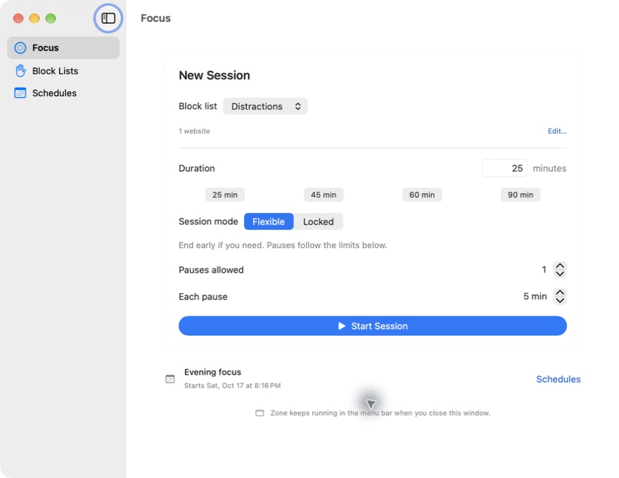

# Zone

A small, native macOS menu-bar app that helps you stay focused. Block distracting websites and apps for a few minutes, or put focus time on a schedule.

Built with SwiftUI and AppKit. Everything stays on your Mac. No account, subscription, analytics, or third-party runtime dependencies.



## Features

- **Quick sessions:** pick a duration or use a 25, 45, 60, or 90-minute preset.
- **Schedules:** repeat on selected weekdays, including overnight sessions, or plan a session just once.
- **Block lists:** group websites and apps for different kinds of work. Domains include their subdomains.
- **Flexible or locked:** end a flexible session early, or commit until a locked session ends.
- **Configurable pauses:** choose the length and number of pauses before starting. Pauses resume automatically and do not extend the session.
- **Menu-bar controls:** see time remaining, pause, resume, or start another session without opening the main window.
- **Local persistence:** sessions survive app restarts, reconcile after sleep, and can start automatically with Open at Login.

Running sessions keep a snapshot of their rules and pause settings. Overlapping sessions combine their blocks; pausing one leaves the others in effect.

## Build and run

Requires macOS 15 or later, Xcode 26 or later (Swift 6.2+), and [XcodeGen](https://github.com/yonaskolb/XcodeGen).

```sh
git clone https://github.com/morajabi/zone.git
cd zone
brew install xcodegen
./scripts/build.sh
open build/Build/Products/Debug/Zone.app
```

The local build supports browser control and app blocking **without a paid Apple Developer account**. It uses ad-hoc signing; rebuilding may require granting Automation permission again.

Build scripts default to two concurrent Xcode jobs. Set `ZONE_BUILD_JOBS=1` to reduce concurrency further, or raise it on a dedicated build machine.

To edit in Xcode, run `xcodegen generate` and open `Zone.xcodeproj`. The generated project is ignored; edit `project.yml` for project changes.

## Start focusing

1. Create a block list from **Focus** and add websites or apps.
2. For websites, open **Zone → Settings → Websites** (`⌘,`) and connect each browser you use. Zone opens the browser if needed; approve its macOS Automation prompt.
3. Choose a duration, mode, and pause allowance, then start the session. Save work in any selected apps first.
4. Use the menu bar to pause or resume. To plan future sessions, open **Schedules**. Turn on **Open at Login** in Settings if you want Zone to run after a restart.

If browser access was denied, allow Zone under **System Settings → Privacy & Security → Automation**.

## How blocking works

**Browser control is the default.** Zone reads tab addresses through macOS Apple Events and redirects blocked tabs to a bundled local page. It does not change network settings, read page contents, or save browsing history. Safari, Chrome, and Dia have been tested live. Adapters also exist for Arc, Brave, Edge, and Opera; those remain unverified. Browsers without a supported automation interface, including Firefox, can be blocked as apps.

The check is periodic, so a page may appear briefly before redirection. Zone must stay running. During a pause or after a session, use Back to return to a redirected page; tabs are not restored automatically.

**App blocking closes selected apps just after launch.** It asks them to quit, then force quits if needed, which can discard unsaved changes. It does not prevent macOS from launching the process.

**Locked mode is a personal commitment.** Zone hides early-ending controls and prevents normal quitting until the session ends. It is not tamper-proof: force quitting Zone bypasses browser and app blocking.

An **optional network filter** is available for advanced builds. It needs Apple provisioning and macOS approval, and its traffic coverage is still experimental. See [network-filter setup and limitations](docs/network-filter.md). Browser control is the simpler supported path.

## Development

```sh
swift test
./scripts/build.sh
```

- `Sources/Zone`: native UI, browser automation, app blocking, login support, and optional filter lifecycle.
- `Sources/ZoneCore`: models, scheduling, pause rules, domain matching, persistence, and network metadata parsing.
- `Sources/ZoneFilter` and `Shared`: optional system extension and authenticated XPC.
- `Tests/ZoneCoreTests`: deterministic tests for scheduling, DST, overlap, lock/pause behavior, persistence, and parsing.

Signing is configurable through `Config/Base.xcconfig`. Copy `Config/Signing.xcconfig.example` to the ignored `Config/Signing.xcconfig` to supply your own team and bundle identifiers. Profiles, keys, and local signing settings are never committed.

Data is stored in `~/Library/Application Support/Zone/sessions.json`, written atomically with owner-only permissions. Unreadable data is preserved instead of silently replaced.

See [contributing](CONTRIBUTING.md) and [tested behavior and remaining gaps](docs/acceptance.md).

## License

[MIT](LICENSE) © 2026 Mo Rajabi.
