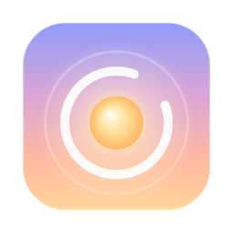
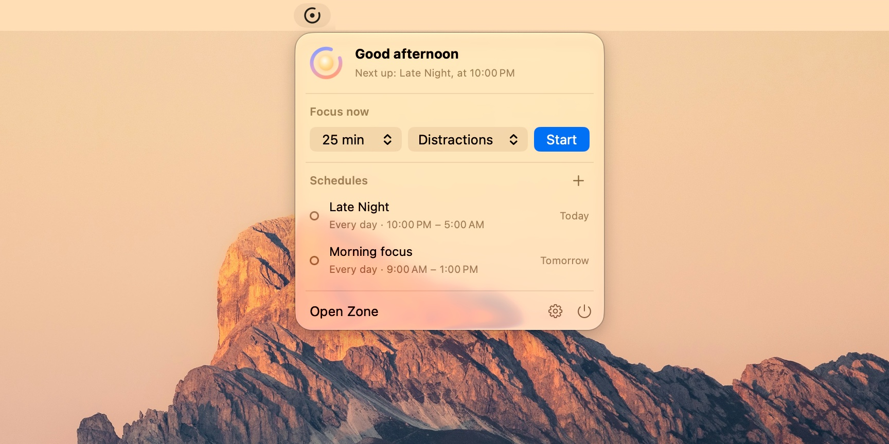
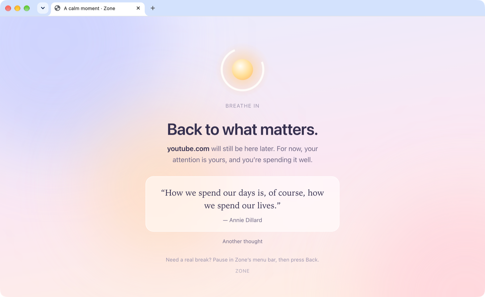

<p align="center">
  
</p>
<h1 align="center">Zone</h1>
<p align="center">
  A calm little focus app for your Mac.
  <br><br>
  <a href="https://github.com/morajabi/zone/releases/latest"><b>Download</b></a> ·
  <a href="#build-it-yourself">Build from source</a> ·
  <a href="https://github.com/morajabi/zone/issues">Report an issue</a>
</p>



Zone lives in your menu bar and keeps distracting websites and apps out of the way while you focus. Start a session in one click, or put focus time on a schedule and let Zone take care of it.

It's free and open source. No account, no tracking, nothing leaves your Mac.

## What it does

- **One click to focus.** Pick how long and what to block, then hit Start.
- **Schedules that stick.** Plan focus time for the days you choose. Once a scheduled session starts, it stays on until it's over. No turning it off halfway through.
- **Breaks, built in.** Take a short pause when you need one. Blocking comes back on its own.
- **A kinder blocked page.** Open something you shouldn't, and you get a moment to breathe and a good quote instead of an error.
- **Always close by.** Your countdown and schedules are one click away in the menu bar.



## Get started

1. [Download Zone](https://github.com/morajabi/zone/releases/latest), open the disk image, and drag Zone to Applications.
2. Open Zone and make a block list with the websites and apps that pull you away.
3. Go to **Settings → Websites** and connect the browsers you use. macOS will ask you to allow it.
4. Start a session from the menu bar, or add a schedule. Turn on **Open at Login** so schedules run after a restart.

Works on macOS 15 or later, on Apple silicon and Intel. Signed and notarized by Apple.

## How blocking works

**Websites.** Zone checks the address of your open tabs and sends blocked ones to its own local page. It doesn't read page content, keep your history, or touch network settings. Tested with Safari, Chrome, and Dia. Arc, Brave, Edge, Opera, and Helium should work too. Firefox and other browsers can be blocked as apps.

**Apps.** Blocked apps are closed right after they open. Save your work before you start, because Zone may need to force quit them.

**Sticking to it.** One-off sessions can be flexible or locked. Scheduled sessions are always strict: you can take the breaks you set, but you can't end them early, change the schedule, or quit Zone until they're done. Restarting or shutting down your Mac still works, and the session picks up when Zone opens again.

That said, Zone is a commitment, not a cage. It needs to be running to block anything, and force quitting it gets around the blocks.

There's also an optional network filter in the signed download. It's experimental and needs macOS approval. [Read more](docs/network-filter.md).

## Build it yourself

You'll need macOS 15 or later, Xcode 26 or later, and [XcodeGen](https://github.com/yonaskolb/XcodeGen).

```sh
git clone https://github.com/morajabi/zone.git
cd zone
brew install xcodegen
./scripts/build.sh
open build/Build/Products/Debug/Zone.app
```

Local builds block websites and apps without a paid Apple Developer account. They're signed ad hoc, so macOS may ask for browser access again after you rebuild.

## Development

```sh
swift test
./scripts/build.sh
```

- `Sources/Zone`: the app, menu bar, browser and app blocking.
- `Sources/ZoneCore`: sessions, schedules, pauses, and saved data, with tests in `Tests/ZoneCoreTests`.
- `Sources/ZoneFilter` and `Shared`: the optional network filter.

Your data is saved in `~/Library/Application Support/Zone/sessions.json`. See [contributing](CONTRIBUTING.md), [releasing](docs/releasing.md), and [what's been tested](docs/acceptance.md).

## License

[MIT](LICENSE) © 2026 Mo Rajabi
